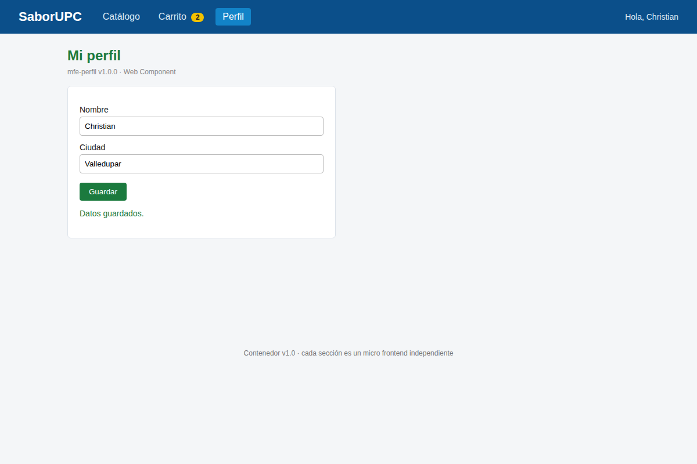

# Preguntas de reflexión

**1. ¿Qué información necesita el contenedor sobre cada micro frontend? ¿Qué no necesita saber?**

Necesita solo lo que está en `registro.js`: la ruta que atiende, la URL donde está desplegado, el tipo
de integración (`funcion` o `webcomponent`) con el nombre de las funciones o de la etiqueta, y si debe
precargarse. También conoce los eventos públicos que escucha (`carrito:actualizado`, `usuario:cambio`).
No necesita saber cómo está construido por dentro (tecnología, HTML, CSS), qué datos maneja (platos,
ítems del carrito, datos del perfil), cómo guarda su estado ni con qué otros micro frontends se comunica.

**2. Compare los contratos de Catálogo (funciones globales) y Perfil (Web Component).**

- *Funciones globales.* Ventaja: muy simple y explícito; el contenedor controla cuándo montar y desmontar
  y en qué elemento. Desventaja: contamina `window` y depende de nombres que deben coincidir exactamente
  (`nombre: 'Catalogo'` ↔ `renderCatalogo`); dos equipos pueden pisarse y no hay aislamiento de estilos
  (solo prefijos por convención).
- *Web Component.* Ventaja: es un estándar del navegador; el ciclo de vida (`connectedCallback` /
  `disconnectedCallback`) lo gestiona el navegador y el Shadow DOM aísla los estilos en ambos sentidos.
  Desventaja: el registro de etiquetas también es global y no se puede redefinir una etiqueta (no conviven
  dos versiones con el mismo nombre); además, compartir estilos comunes y algunas pruebas o SEO son más
  difíciles a través del Shadow DOM.

**3. ¿Por qué el carrito debe precargarse? Otra forma de resolverlo sin precarga.**

El carrito registra su listener de `carrito:agregar` al cargarse el script. Si no estuviera cargado
cuando el catálogo publica el evento, el evento se perdería y el contador no cambiaría. Alternativas:
que el estado del carrito viva en un almacenamiento compartido (`localStorage` o `sessionStorage`) que el
catálogo actualice y el carrito lea al montarse; que el contenedor ofrezca un pequeño bus de eventos que
guarde los eventos pendientes y los entregue cuando el carrito se suscriba; o mover el carrito a un
servicio backend (el catálogo hace un `POST` y el carrito consulta al montarse).

**4. Durante el paso 9.1, ¿qué piezas tuvieron que volver a "desplegarse"? Relación con *lockstep release*.**

Solo `mfe-catalogo`: se editó `catalogo.js` y bastó con recargar. El contenedor, el carrito y el perfil no
se modificaron ni se reiniciaron. Eso es lo contrario de un *lockstep release*, en el que todas las partes
deben publicarse juntas y al mismo ritmo. Aquí cada equipo despliega cuando quiere mientras respete el
contrato (funciones, etiqueta y eventos).

**5. Un riesgo de usar funciones en `window` como contrato y una mitigación.**

Riesgo: colisiones y sobrescrituras. Cualquier script puede reemplazar `window.renderCatalogo` (por error o
intencionalmente), y un renombre no avisado rompe el contenedor en tiempo de ejecución sin aviso previo.
Mitigación: un único espacio de nombres registrado y congelado, por ejemplo
`window.SaborUPC.registrar('catalogo', { render, unmount })` con `Object.freeze`, más validación en el
contenedor (`typeof render === 'function'`) y pruebas de contrato automatizadas en el pipeline de cada equipo.

**6. Si SaborUPC creciera a 10 equipos, ¿qué problemas de gobernanza aparecerían?**

- *Versiones de eventos:* cambiar `precio` por `valor` rompe a los consumidores; se necesita un catálogo
  de eventos documentado, versionado (`carrito:agregar.v2`), con período de convivencia y deprecación.
- *Estilos:* prefijos que chocan, apariencia inconsistente y CSS global que se filtra; hace falta un sistema
  de diseño compartido (tokens CSS) y reglas de aislamiento obligatorias (prefijos o Shadow DOM).
- *Pruebas:* nadie es dueño de los flujos que cruzan equipos; se requieren pruebas de contrato por evento y
  pruebas end-to-end compartidas, más un entorno de integración.
- *Otros:* dueño único del registro y del contenedor, carga duplicada de dependencias (rendimiento),
  convenciones de rutas y nombres, y monitoreo de errores por micro frontend.
